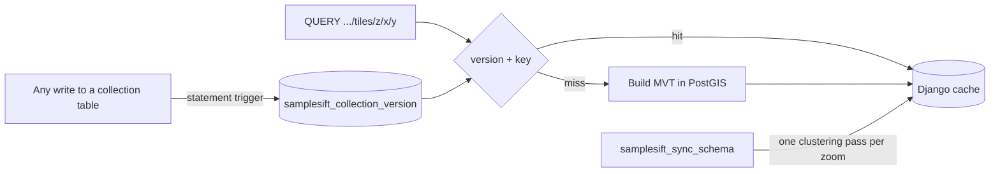

# Tile caching

This document explains how SampleSift caches vector tiles for spatial collections,
how cached tiles are invalidated, and how the schema and content sync commands prewarm the
cache. The [collection documentation](django-collections.md#api-settings) summarises
the settings. This document describes the mechanism behind them.

## Overview



- Each collection table has a **version**: the time of its last write, maintained by a
  database trigger.
- A tile's **cache key** contains that version and a hash of everything else that
  determines the tile's bytes.
- A write changes the version, so every key built afterwards is new. Old entries are
  never deleted explicitly; they become unreachable.
- **Prewarming** builds every non-empty unfiltered tile for the clustered zooms,
  clustering once per zoom, and stores them under the current version.

## Enabling the cache

Caching is off unless the host opts in, either by:

- defining Django's `CACHES` setting (SampleSift then uses the `default` cache), or
- setting `SAMPLESIFT_CACHE_ALIAS` to the name of a configured cache.

Django supplies an implicit local-memory cache even without `CACHES`. SampleSift
ignores it, because a per-process cache is rarely what a deployment wants. With
several workers, use a shared backend such as Redis.

A request computes its tile without the cache when:

| Condition | Reason |
| --- | --- |
| No cache is configured | Caching is opt-in. |
| The collection database connection is inside a transaction | The transaction may hold uncommitted writes that the version does not reflect yet. |
| The collection has no version row | `samplesift_sync_schema` has not installed the version trigger yet. |

## Collection versions

`samplesift_sync_schema` installs, in the collection database (`SAMPLESIFT_DATABASE_ALIAS`):

```sql
CREATE TABLE IF NOT EXISTS samplesift_collection_version (
    table_name text PRIMARY KEY,
    synced_at timestamptz NOT NULL
);

CREATE OR REPLACE FUNCTION samplesift_touch_version() RETURNS trigger ... AS $$
BEGIN
    INSERT INTO samplesift_collection_version (table_name, synced_at)
    VALUES (TG_TABLE_NAME, clock_timestamp())
    ON CONFLICT (table_name) DO UPDATE SET synced_at = clock_timestamp();
    RETURN NULL;
END $$;

-- for every spatial collection table:
CREATE OR REPLACE TRIGGER samplesift_version
    AFTER INSERT OR UPDATE OR DELETE OR TRUNCATE ON "<collection table>"
    FOR EACH STATEMENT EXECUTE FUNCTION samplesift_touch_version();
```

It also adds a row for each table that has none, so tables populated before the
trigger existed still get a version. Every statement here is idempotent. Existing
deployments upgrade by running the command again, and it requires PostgreSQL 14 or
later for `CREATE OR REPLACE TRIGGER`. Like the collection tables themselves, these
objects are created by the command, not by Django migrations.

### Why a trigger

The version must change whenever the tile contents could change. A trigger records
every write path, not just SampleSift's signal synchronization:

- ORM saves and deletes;
- `QuerySet.update()`, bulk creates, and raw SQL;
- `TRUNCATE`;
- external loaders.

The version row is updated in the same transaction as the write. If the write rolls
back, so does the version change, and other sessions see the new version exactly when
they can see the new data.

The trigger runs once per statement, not per row, so a bulk insert of a million rows
costs one version update. A statement that affects no rows still changes the version.
That causes an unnecessary but harmless invalidation.

### Why `clock_timestamp()`

`now()` is fixed at the start of a transaction, so two concurrent transactions can
record the same value or record values out of commit order. `clock_timestamp()` is
the wall-clock time when the trigger runs.

Correctness only requires that the value differs from every earlier one. It does not
need to increase. In theory, a system clock stepping backwards could reproduce an old
timestamp; in practice, microsecond resolution makes this negligible.

The version is exposed as epoch microseconds (for example `1762856130123456`) to keep
keys short and readable.

### Write contention

Concurrent transactions writing to the *same* collection table update the same version
row, so each waits at the trigger for the previous one to commit. Signal
synchronization uses one short transaction per source save, so the wait is short. A
long bulk load holds the row lock until it commits and blocks other writers to that
collection in the meantime. Different collections never contend with each other.

## Cache keys

```
samplesift:tile:<api_name>:<version>:<sha256>
```

| Part | Content |
| --- | --- |
| `api_name` | The collection's API name; keeps keys of different collections apart and inspectable. |
| `version` | The collection version described above. |
| `sha256` | Hash of the JSON array `[table_name, z, x, y, SAMPLESIFT_CLUSTER_RADIUS_PIXELS, SAMPLESIFT_CLUSTER_MAX_ZOOM, filter]`. |

Only the body's `filter` property affects tile bytes, so it is the only part of the
request body that is hashed. `{}`, `{"filter": null}` and a body that also contains
`limit` therefore share a key. The filter is serialised with sorted object keys, so
equivalent CQL2 objects written with properties in a different order share a key too.
Clustering settings are part of the hash, so changing them and restarting does not
serve tiles computed with the old values.

Django's own `KEY_PREFIX` and key version, if configured, are applied on top of this
key by the cache backend.

## Request lifecycle

For `QUERY /samplesift/collections/{api_name}/tiles/{z}/{x}/{y}`:

1. Validate the filter and tile coordinates, so invalid requests fail with 422 even
   when a matching key exists.
2. Return the computed tile without caching in the bypass cases above.
3. Read the collection version (one primary-key lookup).
4. Build the key and look it up. On a hit, return the cached bytes.
5. On a miss, build the tile and store it with `SAMPLESIFT_CACHE_TIMEOUT`.

The version is read *before* the tile query. Under PostgreSQL's default READ
COMMITTED isolation, the tile query then sees data at least as new as the version.
Suppose a write commits between steps 3 and 5: the newer tile is stored under the
older version, and the next request reads the new version and never looks at it. The
reverse can't happen: a stale tile can never be stored under the current version.

## Invalidation and memory

Nothing deletes old entries. After a write:

- request-time tiles under older versions remain until `SAMPLESIFT_CACHE_TIMEOUT` expires;
- prewarmed tiles under older versions remain until the backend evicts them.

Configure the backend to evict when full. For Redis, set `maxmemory` and use
`allkeys-lru` (prewarmed keys have no TTL, so `volatile-*` policies would never evict
them). The OBIS example runs Redis with `--maxmemory 256mb --maxmemory-policy allkeys-lru`.

To size the cache, one set of prewarmed tiles is roughly the number of non-empty
tiles through `SAMPLESIFT_CLUSTER_MAX_ZOOM` multiplied by the average tile size.
Allow room for at least two sets, because the previous version's tiles stay until
they are evicted. Also allow for request-time tiles of filtered queries.

## Prewarming

`samplesift_sync_schema` prewarms after creating tables and installing triggers when:

- a cache is configured, and
- `--no-warm-cache` was not passed.

For every spatial API collection, it stores each non-empty tile of the **unfiltered**
query for zooms `0` to `SAMPLESIFT_CLUSTER_MAX_ZOOM`, then prints the number of tiles
it stored.

`samplesift_sync_content` also prewarms after refreshing rows and removing orphans.
It warms only the selected spatial collections, using their updated versions.
The same cache requirement and `--no-warm-cache` option apply.

### Cluster once per zoom

An on-demand clustered tile runs `ST_ClusterDBSCAN` over the whole filtered
collection, because clusters can cross tile edges. Warming tile by tile would repeat
that once per tile; at zoom 14 there are about 268 million tiles. Prewarming instead
runs **one statement per zoom**:

```
filtered rows ──► ST_ClusterDBSCAN (eps = radius at z) ──► one row per cluster
                                                            (fields, point_count,
                                                             cluster_id, centroid)
        ┌───────────────────────────────────────────────────────────┘
        ▼
candidate tiles per centroid ──► ST_AsMVTGeom(centroid, ST_TileEnvelope(z, tx, ty))
        │                         drop NULL (centroid not in that tile)
        ▼
GROUP BY (tx, ty) ──► ST_AsMVT(... ORDER BY cluster_id) ──► (version, x, y, bytes)
```

- **Clustering.** The `filtered`, `grouped` and `clusters` CTEs are produced by the same
  function (`_clusters_sql`) that on-demand tiles use. The two paths therefore cannot
  disagree about membership, properties or cluster IDs.
- **Candidate tiles.** For a centroid at Web Mercator `(X, Y)` and tile size
  `s = 2 · 20037508.342789244 / 2^z`, the fractional tile column is
  `fx = (X + 20037508.342789244) / s` and the row is
  `fy = (20037508.342789244 − Y) / s`. The candidates are every integer from
  `floor(f − 1/4096)` to `floor(f + 1/4096)` on each axis, clamped to the tile grid.
  - This is usually one tile.
  - A centroid within one MVT pixel of a tile edge is offered to both neighbours.
    `ST_AsMVTGeom` snaps to the 4096 grid, so a centroid up to half a pixel past an
    edge lands on it and belongs to both tiles.
- **Exact selection.** `ST_AsMVTGeom` is then applied with each candidate tile's
  envelope, exactly as for an on-demand tile, and returns NULL for tiles that would not
  contain the feature. The candidates only have to *include* the right tiles; PostGIS
  decides the final set.
- **Deterministic bytes.** Both paths aggregate features `ORDER BY cluster_id`, so a
  prewarmed tile is byte-identical to the tile the request path would build. The
  integration test `tests/integration/test_tile_warm.py` checks this for every tile
  through zoom 3, including centroids on tile edges.
- **Consistent version.** The same statement selects the collection version. The
  version and the tiles therefore come from one snapshot, and the tiles are stored under
  exactly the version they reflect. No long-running transaction is needed.

### Streaming

Each zoom's statement runs through a server-side cursor (`chunked_cursor()`), so tiles
are streamed rather than loaded at once. They are written with `cache.set_many()` in
batches of 500, with no expiry.

The database's memory use is that of clustering the whole collection once. Python's
memory use is bounded by the batch size.

The run takes roughly `SAMPLESIFT_CLUSTER_MAX_ZOOM + 1` full-collection clustering
passes (15 by default), plus the time to encode and transfer the non-empty tiles. At
high zooms, the cost is dominated by the number of non-empty tiles.

### What is not warmed

- **Filtered queries.** Only the unfiltered query is warmed; filtered tiles are cached
  when first requested.
- **Empty tiles.** Tiles with no features are not stored, so a request for one still
  runs the clustering query. A "this zoom is fully warmed" marker could answer these
  without a query. It is deliberately absent: if a single tile were evicted, the
  marker would make the request path serve it as empty.
- **Individual-point zooms** above `SAMPLESIFT_CLUSTER_MAX_ZOOM`. These tiles only query
  their own bounds, so they are cheap to build on demand.

### When to run it

Any write changes the version, so warm *after* data changes:

- Run `samplesift_sync_content` after bulk imports into source tables or changes to resolver code.
  It refreshes collection rows and then prewarms their tiles.
- Run `samplesift_sync_schema` after bulk loads or reconciliation. Deployment scripts
  that load data after creating the schema can run
  `samplesift_sync_schema --no-warm-cache` first and the plain command afterwards, as
  the [OBIS example](../examples/obis/entrypoint.sh) does.
- With continuous signal synchronization, each write invalidates the warmed tiles.
  Rewarm on a schedule (for example from cron) that matches how often stale tiles
  become acceptable to recompute on demand.

## Operations

List the tiles for a collection, optionally for one version:

```sh
redis-cli --scan --pattern '*samplesift:tile:<api_name>:*'
redis-cli --scan --pattern '*samplesift:tile:<api_name>:<version>:*' | wc -l
```

The leading `*` matches Django's key prefix and key version. Find the current version:

```sql
SELECT table_name,
       synced_at,
       (extract(epoch FROM synced_at) * 1000000)::bigint AS version
FROM samplesift_collection_version;
```
